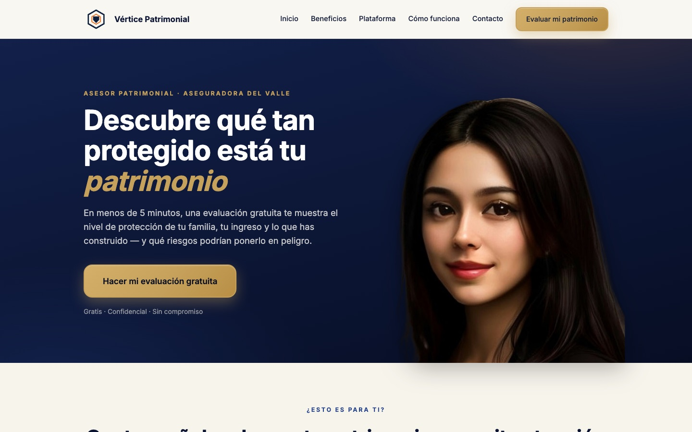
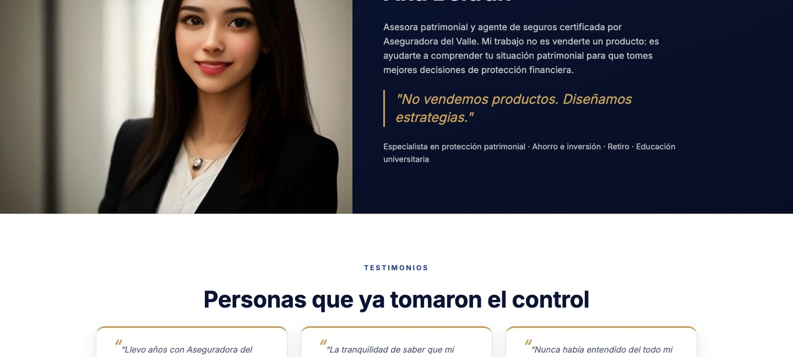
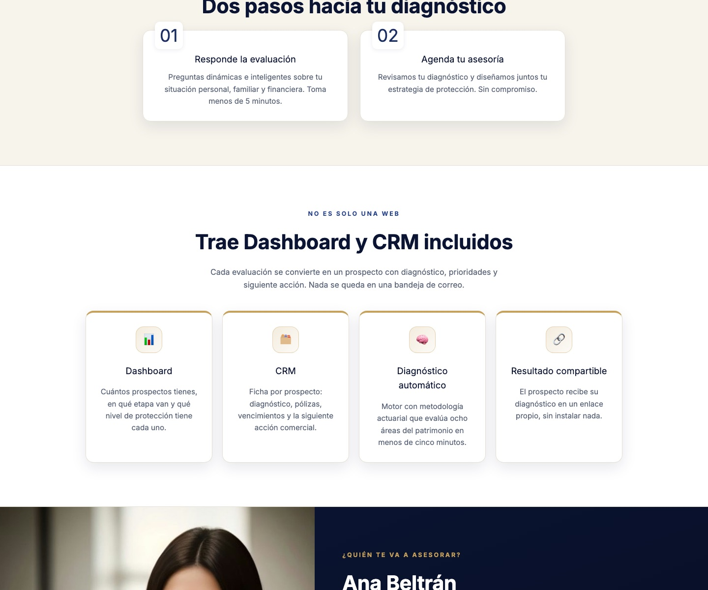

# Landing page de ventas + Panel de control + Diseño a tu medida

**Vértice Seguros** — el sistema completo para agentes y vendedores de seguros:
una sola aplicación que convierte visitantes en prospectos calificados.

El visitante responde una evaluación, el motor calcula su nivel de protección en ocho
áreas del patrimonio, y el agente recibe el prospecto con diagnóstico, prioridades y
siguiente acción comercial — todo dentro del mismo sistema, sin hojas de cálculo ni
plugins.

> Demo público: *(pendiente de publicar)*



## Lo que ves

| Landing | Incluye Dashboard + CRM |
|---|---|
|  |  |

---

## Qué incluye

| Módulo | Qué hace |
|---|---|
| **Landing page** | Página de venta configurable: marca, colores, foto del asesor, productos y WhatsApp. Diseño editorial, alto contraste, optimizada para conversión. |
| **Evaluación** | Formulario multi-paso que captura el perfil del prospecto con validación de teléfono mexicano. |
| **Motor de diagnóstico** | Evalúa ocho áreas (protección familiar, salud, ingresos, movilidad, hogar, educación, retiro, negocio) y produce un nivel de protección con prioridades. |
| **Resultado compartible** | Cada prospecto recibe su diagnóstico en un enlace propio, sin instalar nada. |
| **Dashboard** | Vista de prospectos: cuántos hay, en qué etapa van y su nivel de protección. |
| **CRM** | Ficha por prospecto con pólizas, vencimientos, productos y siguiente acción comercial. |

## Stack

**Frontend** — React 19 · TypeScript · Vite · Tailwind CSS 4 · React Router
**Backend** — Django + Django REST Framework · PostgreSQL 18 · Redis 8
**Infra** — Docker Compose · nginx · Gunicorn

## Cómo correrlo

```bash
cp .env.example .env      # ajusta credenciales y KNOWLEDGE_PATH
docker compose up -d --build
```

- Frontend: `http://localhost:8080`
- API: `http://localhost:8000/api/`

## Conocimiento del motor

El motor de diagnóstico carga su base de conocimiento desde `KNOWLEDGE_PATH`.
Este repositorio incluye **`knowledge.example.json`** con una estructura de ejemplo:
ocho áreas, tres productos genéricos y reglas mínimas.

La base completa (productos reales, cédulas, reglas de venta afinadas) **no está
incluida**: es el activo que se personaliza por cliente.

## Personalización

Este proyecto se adapta a la medida: tu marca, tu aseguradora, tus productos y tus
reglas de venta. Incluye opcionalmente integración con WhatsApp y redes sociales.

## Licencia

MIT — úsalo, modifícalo y constrúyelo. La marca "Vértice Seguros" y sus assets no
están cubiertos por la licencia.

---

*Los nombres, productos, aseguradora y datos de contacto incluidos son ficticios y
sirven como ejemplo.*
